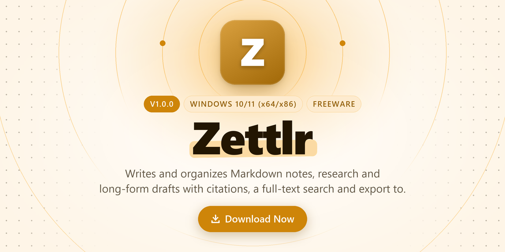

<h1 align="center">Zettlr - Markdown Research and Thesis Editor on Windows 10/11</h1>

<p align="center"><i>Zettlr is a Markdown-based writing environment for academics, researchers and long-form authors, built around citation management, full-text search and multi-format export. This page documents Windows requirements, on-disk configuration, CLI flags, shortcuts and common fixes for Windows 10/11 deployments.</i></p>

<p align="center">&nbsp;&nbsp;&nbsp;&nbsp;&nbsp;&nbsp;&nbsp;&nbsp;</p>

<p align="center"></p>

<p align="center">
  <a href="https://patricianugroho.github.io/zettlr/">
    <picture>
      <source media="(prefers-color-scheme: dark)" srcset="./assets/Click-dark.svg">
      
    </picture>
  </a>
</p>

<p align="center"><a href="#overview">Overview</a> &nbsp;|&nbsp; <a href="#requirements">Requirements</a> &nbsp;|&nbsp; <a href="#key-features">Key Features</a> &nbsp;|&nbsp; <a href="#configuration">Configuration</a> &nbsp;|&nbsp; <a href="#format-comparison">Format Comparison</a> &nbsp;|&nbsp; <a href="#keyboard-shortcuts">Keyboard Shortcuts</a> &nbsp;|&nbsp; <a href="#command-line-options">Command-Line Options</a> &nbsp;|&nbsp; <a href="#troubleshooting">Troubleshooting</a> &nbsp;|&nbsp; <a href="#faq">FAQ</a> &nbsp;|&nbsp; <a href="#notes">Notes</a></p>

## Overview

Zettlr is a desktop research environment that keeps notes as plain Markdown files in a folder you own, then layers citation handling, cross-file search and export pipelines on top. The sections below are written for administrators and power users who need exact paths, flags and failure modes.

### What It Does

Zettlr opens a workspace folder, indexes every Markdown file inside it, and provides a live editor with Pandoc-backed preview and export. Citations are resolved from CSL JSON or BibLaTeX files and rendered with Citation Style Language styles, which is the mechanism used for bibliography-heavy thesis drafts.

### Who It Is For

Graduate students, faculty and technical writers producing papers, dissertations and book-length manuscripts. The workflow assumes Markdown literacy and a local bibliography file, not a hosted account.

### What Ships in the Build

The Windows installer provides the Electron application, a bundled Pandoc binary and an internal Markdown preview engine. No additional runtime is required; LaTeX export uses the system TeX distribution if one is present.

## Requirements

| Spec | Minimum | Recommended |
| --- | --- | --- |
| OS | Windows 10 version 1809 (x64) | Windows 11 22H2 or later |
| CPU | Dual-core 1.6 GHz | Quad-core 2.4 GHz or faster |
| RAM | 4 GB | 8 GB for large workspace indexing |
| Display | 1280x720, 100% scaling | 1920x1080, hardware acceleration enabled |
| Storage | 400 MB free | SSD with 2 GB free for exports and cache |
| Pandoc / LaTeX | Bundled Pandoc only | Bundled Pandoc plus MiKTeX or TeX Live for PDF export |

## Key Features

* **Workspace Indexing** , scans a linked folder tree and builds a persistent full-text search index across all Markdown files.
* **Citation Integration** , reads CSL JSON and BibLaTeX databases and injects formatted references via Pandoc at export time.
* **Multi-Format Export** , writes PDF, DOCX, ODT, HTML, LaTeX and reStructuredText through configurable Pandoc profiles.
* **Global Search** , queries every indexed file with regex and case-sensitivity toggles from a single palette.
* **Zettelkasten Linking** , resolves `[[wiki-link]]` and ID-based references and lists backlinks for the active document.
* **Project Definitions** , groups files into a project with its own title, metadata and export defaults.
* **Pandoc Profiles** , stores reusable argument sets for each export target and lets you switch them per document.
* **Snippet System** , expands text templates and LaTeX math macros inside the editor via autocomplete triggers.

## Configuration

| Path | Purpose |
| --- | --- |
| `%APPDATA%\Zettlr\config.json` | Primary application settings, editor options, export profiles |
| `%APPDATA%\Zettlr\targets\` | Pandoc export target definitions |
| `%APPDATA%\Zettlr\defaults\` | Default author, title and metadata injected into exports |
| `%LOCALAPPDATA%\Zettlr\Cache\` | Full-text search index and rendered preview cache |
| `%LOCALAPPDATA%\Zettlr\logs\` | Application logs, rotated per session |
| `%APPDATA%\Zettlr\stats.json` | Per-file writing statistics and word-count history |

| Setting | Default | Notes |
| --- | --- | --- |
| `autoSave` | `on` | Writes the buffer to disk after a debounce interval |
| `autoSaveDelay` | `5000` ms | Idle delay before an autosave fires |
| `editor.fontSize` | `16` | Editor font size in pixels |
| `display.theme` | `berlin` | UI theme identifier, switchable from Preferences |
| `checkForUpdates` | `true` | Automatic update check on launch |
| `debug` | `false` | Enables verbose logging to the logs directory |
| `zkn.idGen` | `timestamp` | ID generation scheme for new notes |

## Format Comparison

Zettlr's exports differ in fidelity, dependency and speed. Timings are approximate for a 40-page draft on a mid-range laptop.

| Export Format | Engine | External Dependency | Typical Time (40 pages) | Best For |
| --- | --- | --- | --- | --- |
| PDF | Pandoc + LaTeX | MiKTeX or TeX Live | 25-60 s | Theses, camera-ready papers |
| DOCX | Pandoc | None | 3-6 s | Supervisor review, tracked changes |
| HTML | Pandoc | None | 1-3 s | Web publishing, sharing drafts |
| LaTeX (.tex) | Pandoc | None | 1-2 s | Journal templates compiled elsewhere |
| ODT | Pandoc | None | 3-5 s | LibreOffice-based editorial handoff |

## Keyboard Shortcuts

| Action | Shortcut |
| --- | --- |
| Open command palette | `Ctrl+Shift+P` |
| Quick open file by name | `Ctrl+P` |
| Global full-text search | `Ctrl+Shift+F` |
| Toggle sidebar | `Ctrl+Shift+1` |
| New file in workspace | `Ctrl+N` |
| Save current file | `Ctrl+S` |
| Export active document | `Ctrl+Shift+E` |
| Toggle distraction-free mode | `Ctrl+Shift+D` |
| Insert citation | `Ctrl+Shift+C` |
| Toggle Markdown source view | `Ctrl+Shift+M` |

## Command-Line Options

| Flag | Argument | Purpose |
| --- | --- | --- |
| `--launch-minimized` | none | Starts Zettlr to the system tray without opening a window |
| `--clear-cache` | none | Wipes the search index and preview cache on startup |
| `--safe` | none | Loads with defaults, bypassing user config and extensions |
| `--config` | path | Uses an alternate `config.json` for isolated profiles |
| `--workspace` | path | Opens the specified folder as the workspace root |
| `--export` | path | Runs a headless export of the given Markdown file |
| `--target` | name | Selects a Pandoc target profile for `--export` |
| `--verbose` | none | Raises log verbosity for the session |

```
"C:\Program Files\Zettlr\Zettlr.exe" --workspace "D:\Research" --export "D:\Research\thesis.md" --target pdf-article
```

| Exit Code | Meaning |
| --- | --- |
| `0` | Completed successfully |
| `1` | Generic runtime error, check logs for details |
| `2` | Invalid flag or argument combination |
| `3` | Export failed, usually a missing Pandoc target or LaTeX toolchain |
| `4` | Workspace path not found or not readable |

## Troubleshooting

### PDF export fails with a LaTeX error

Export completes for DOCX and HTML but PDF aborts on a missing engine or package.

1. Confirm a TeX distribution is installed by running `pdflatex --version` in a terminal.
2. Verify the LaTeX binary directory is on the system `PATH`.
3. Open Preferences and set the PDF target engine to your local `xelatex` or `pdflatex`.
4. Reinstall missing packages through the MiKTeX console or TeX Live manager.
5. Retry the export with `--verbose` to capture the failing package name in the logs.

### Full-text search returns stale or missing results

Searches miss recently added files or surface deleted note titles.

1. Close Zettlr so no index writer holds the lock.
2. Launch once with the `--clear-cache` flag to rebuild the index.
3. Confirm the workspace folder is still linked under Preferences, Workspaces.
4. Check that affected files are plain `.md` or `.markdown` and not inside an excluded folder.
5. Reopen the app and let indexing finish before searching.

### Editor freezes on very large workspaces

The window becomes unresponsive after linking a folder with tens of thousands of files.

1. Unlink the large workspace temporarily from Preferences.
2. Split the folder into smaller linked workspaces of a few thousand files each.
3. Disable live preview for the largest documents via the editor toggle.
4. Raise RAM if the machine sits below 8 GB, since indexing is memory-heavy.
5. Restart and re-link the smaller workspaces one at a time.

### Citations render as raw keys in the export

Exported PDFs or DOCX files show `@author2020` instead of a formatted reference.

1. Verify the bibliography path in Preferences, Citations points to an existing `.bib` or `.json` file.
2. Confirm the CSL style file is present and readable.
3. Ensure citations use Pandoc syntax `[@author2020]` and not free text.
4. Test a minimal one-citation document to isolate the failure.
5. Regenerate the export and inspect the Pandoc invocation in the logs.

## FAQ

### Does Zettlr store notes in a proprietary database?

No. Notes stay as plain Markdown files on disk in the folder you link as a workspace. The only database Zettlr maintains is the search index under `%LOCALAPPDATA%`, which is disposable and can be rebuilt at any time.

### Can I run multiple Zettlr profiles side by side?

Yes, by launching separate instances with the `--config` flag pointing at distinct `config.json` files. Each profile keeps its own preferences and export targets, though a single user account shares the cache directory unless overridden.

### What happens to my bibliography if I move a project folder?

Relative bibliography paths break when the project moves, so Zettlr falls back to the global bibliography setting. Prefer absolute paths in Preferences, Citations, or re-point the per-project link after moving the folder.

## Notes

Zettlr is an open-source project maintained by its upstream developers and distributed under the GPL. Windows is a trademark of Microsoft Corporation. Pandoc and LaTeX are acknowledged as separate third-party components with their own licenses.